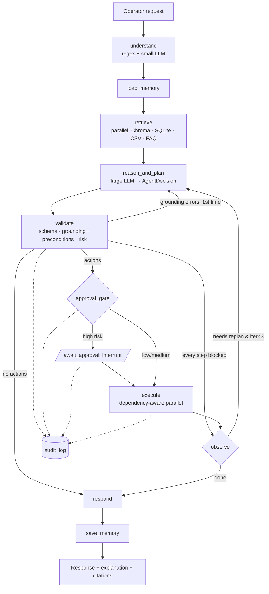
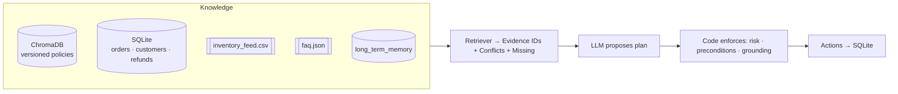
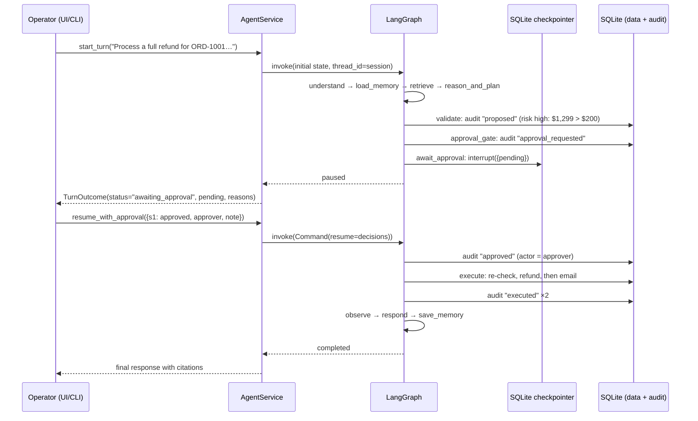

# OpsPilot architecture

OpsPilot is a LangGraph state machine. The LLM does two things: it proposes a structured plan, and it writes explanations. Everything that decides whether an action may happen is deterministic Python: risk levels, approval requirements, business preconditions and citation grounding.

## Agent graph

| Node | What it does | LLM |
|---|---|---|
| `understand` | Regex extracts `ORD-####`, `C-###`, SKUs, emails and product names. The small model adds a one-sentence summary and a request type. Regex always wins on IDs. | small |
| `load_memory` | Loads ≤10 long-term memories for the customers involved (including owners of referenced orders) and the operator. Preferences come first. | — |
| `retrieve` | Two parallel waves over all four sources produce a `RetrievalBundle`: evidence with stable IDs, conflict notes and missing-data notes. | — |
| `reason_and_plan` | Builds the planning prompt (evidence block, conflicts, memories, tools, previous attempts) and parses an `AgentDecision`. Off-domain requests are refused here in code, without calling the model. | large |
| `validate` | Checks citations against the bundle and rejects superseded evidence as a basis for action. Validates tool args and cycles. Classifies risk, writes `proposed` audit rows and runs preconditions. A failed step becomes `skipped` before it can reach approval. | — |
| `approval_gate` | Collects steps that the risk policy says need approval and logs `approval_requested`. | — |
| `await_approval` | `interrupt()` pauses the graph; the checkpoint is persisted. On resume it records `approved` / `rejected` per step. | — |
| `execute` | Topological layers, independent steps in a thread pool (4 workers). Re-checks preconditions right before each tool. Logs `executed` / `failed` / `skipped`. | — |
| `observe` | Folds read-tool results into the evidence. Replans on failures, precondition skips or new information, up to 3 iterations. | — |
| `respond` | Writes the operator-facing explanation. Citations are rewritten to readable labels in code. A deterministic template is the fallback. | large |
| `save_memory` | Extracts durable facts (e.g. "prefers store credit") and a one-line interaction summary per customer. | small |

## Knowledge and enforcement

- **Evidence IDs.** Every fact carries an ID such as `policy:return_policy_v2§2`, `db:orders:ORD-1001`, `csv:inventory:EL-HP-02`, `faq:faq-04` or `memory:12`. The planner may cite only IDs that exist in the bundle.
- **Versioned policies.** Chunks carry `version`, `effective_date` and `supersedes` metadata. If an older version is retrieved, the current one is pulled in as well. The old chunk is marked `superseded` and shown to the model with a superseded, do-not-apply label.
- **Conflicts.** When DB stock and CSV stock disagree, the fresher timestamp wins. Both values stay visible in the evidence, and a `ConflictNote` records the resolution.
- **Missing data.** Gaps such as a missing `delivery_date` or an unknown order are listed explicitly, and preconditions refuse to refund on them.

## Approval flow (sequence)

A rejected step becomes `rejected`. Its dependants are `skipped` ("dependency s1 not executed"), nothing is written to `refunds`, and the agent explains the rejection instead of replanning around it.

## Concurrency and storage

- One SQLite connection per tool call; WAL mode and a busy timeout allow the parallel executor to write safely.
- Chroma client creation is serialised with a lock. Queries themselves run in parallel.
- LangGraph checkpoints live in `data/runtime/checkpoints.db`, with `thread_id = session_id`. Sessions survive restarts and keep multi-turn context.
